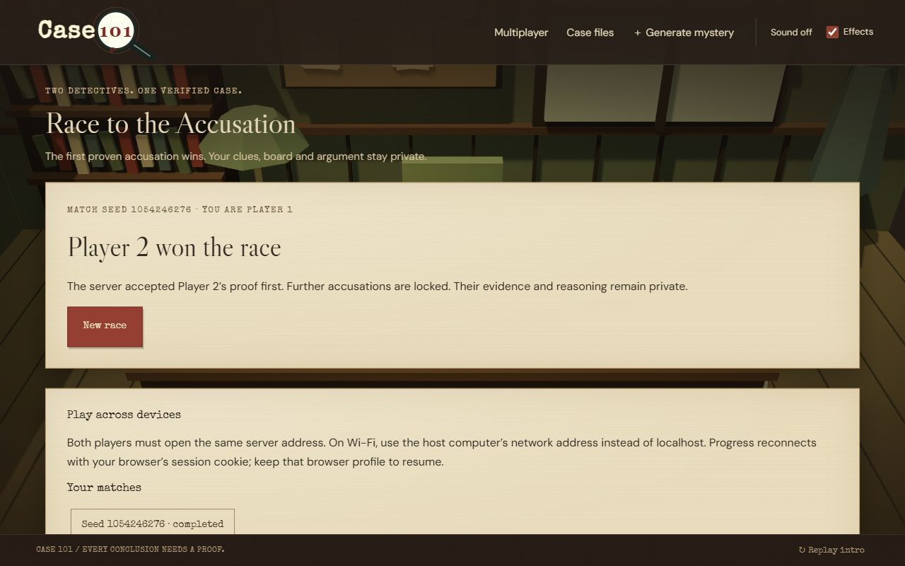
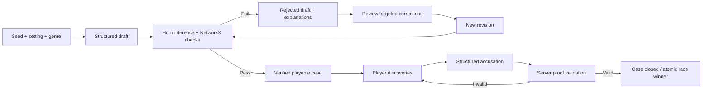

<div align="center">
  
  <h1>Case 101</h1>
  <p><strong>Every secret leaves a trace. Every conclusion needs a proof.</strong></p>
  <p>A low-poly detective game with verifiable mysteries and a two-player race to the first justified accusation.</p>
  <p>React · Three.js · React Flow · FastAPI · NetworkX · SQLite</p>
</div>

---

## What is Case 101?

Procedural mysteries can sound convincing while containing missing clues, incompatible facts, or impossible conclusions. Case 101 treats a mystery as both a story and a directed evidence graph. Every playable case must pass logical verification, and every successful accusation must be supported by evidence the player actually discovered.

Explore atmospheric 3D rooms, interview suspects, pin records to a corkboard, and build a structured argument. Play at your own pace, or invite another detective to investigate the same case privately. In **Race to the Accusation**, the first valid proof accepted by the server wins.



## Features

| Area | What works |
| --- | --- |
| Investigation | Low-poly environments, searchable rooms, suspect interviews, prerequisite-gated clues and a discovered-event timeline |
| Case selection | Case folders, contextual navigation, separate progress and persistent browser sessions |
| Generation | Reproducible seeds; manor, sleeper train and museum settings; murder, theft and sabotage mysteries |
| Verification | Python Horn-rule inference plus actual NetworkX dependency, reachability and cycle checks |
| Corrections | Explained changes, separately versioned corrections, preserved rejected drafts and full reverification |
| Evidence board | Pin/unpin, draggable cards, typed connections, explanations, editable notes and persistent positions |
| Accusations | Evidence-backed claims, contradiction resolution, alternative suspects and assumption testing |
| Multiplayer | Two independent sessions, private progress, invitations, presence, reconnection and one atomic winner |
| Presentation | Kraft folders, paper records, a magnifying-glass logo/cursor, cinematic intro and persistent audio controls |
| Mobile | Responsive forms and touch-sized room-search controls over the same 3D environment |

## Quick start

**Requirements:** Node.js 20.19+ (or 22.12+) and Python 3.12+.

From the repository root:

```powershell
python -m venv .venv
.\.venv\Scripts\Activate.ps1
python -m pip install -r requirements.txt
npm ci
npm run build
npm start
```

On macOS/Linux, activate the environment with `source .venv/bin/activate` instead.

Open **http://127.0.0.1:4174**. FastAPI serves both the compiled frontend and the API, so only one server is needed to play.

For frontend development, keep the Python server running and run `npm run dev` in another terminal. Vite uses port 5173 and proxies `/api` to port 4174. Rebuild before testing changes through the production server.

> On Windows, a playing media file can lock `dist/assets` during a rebuild. Stop the Python server, run `npm run build`, then restart it.

## Single-player flow

1. Enter the archive and select a verified file, or generate a mystery with a setting, type and seed.
2. The backend assembles the draft. Players do **not** choose an error mode.
3. Verification either approves the case or explains the failed checks. Rejected cases cannot start.
4. Review targeted corrections if necessary. Applying a correction creates a new revision and checks it again.
5. Investigate rooms and interview witnesses. Some clues require earlier discoveries.
6. Organize evidence and connect it using meaningful relationships.
7. Build an argument, challenge it, then submit your accusation.
8. A valid proof closes the case. Choosing the correct name without sufficient reasoning does not.

An explicit single-player reveal shows the solution without awarding a justified win. The author graph is a deliberate spoiler view, separate from the player graph.

## Multiplayer: Race to the Accusation

### Create and join

- **Player 1:** choose **Multiplayer → Create Match**, then select the setting and mystery type.
- The server assigns a unique seed, verifies the case and reserves the first slot.
- Share the **match seed and private invitation key** with Player 2. A copy button is available; the fields can also be copied manually.
- **Player 2:** open the same backend on another device or browser profile and choose **Multiplayer → Join Match**.
- Both players can enter the investigation once the second slot is filled.

The seed identifies and reproduces the mystery; it is not an authorization credential. The invitation grants the second slot, and a secure session cookie identifies each player afterward. Normal tabs in the same browser profile share that identity and are **one player**, not two.

### Rules of the race

Both players receive exactly the same verified case and logical rules. Their discoveries, boards, notes and arguments are stored separately on the server.

A submitted accusation uses the existing proof validator. Invalid accusations leave the match active. Any supported proof path can win; there is no required single clue sequence. Validation, progress saving and winner assignment occur inside one SQLite write transaction. Only the first valid submission can complete the match, including when separate backend processes receive simultaneous submissions.

Once completed, further accusations are rejected and both clients receive the same winner announcement. Status responses contain membership/readiness, presence and the outcome—not the opponent's evidence or reasoning. Race cases disable authoring, hidden graph views and solution-reveal shortcuts. Active and completed race seeds are reserved from the public single-player generation API.

### Disconnections and retries

- Authenticated heartbeats synchronize status approximately every **2 seconds**.
- A player appears offline after **15 seconds** without a heartbeat. Background-tab throttling may also trigger this indicator.
- Disconnection does not surrender a slot or award a win. Returning with the same browser cookie resumes progress.
- Repeated create/join requests do not create extra players or reset an investigation.
- Full, cancelled and completed matches reject new participants.
- Either member can cancel an unfinished match; cancellation awards no winner.
- If a session cookie is deleted, that identity cannot be recovered through the seed alone. The remaining player can cancel and start another race.

### Play on two devices over Wi-Fi

```powershell
npm run build
npm run start:lan
```

Find the host computer's Wi-Fi/Ethernet IPv4 address and open:

```text
http://HOST_LAN_IP:4174
```

Use that **same address on both devices**. `localhost` on the second device refers to that second device, not the host.

The host network must permit inbound TCP port 4174 and device-to-device communication. Guest Wi-Fi/client isolation or a firewall can prevent connection; this project does not change firewall rules. LAN HTTP may not offer clipboard permissions, so manual copying remains available.

## How verification works



The graph represents suspects, locations, events, clues, intermediate claims and conclusions. Horn rules require **all** premises in an AND rule; a connected graph path alone is not proof. Fixed-point inference tracks minimal supporting evidence sets, allowing multiple legitimate routes.

The verifier checks:

- Missing references and prerequisites without a discoverable source.
- Cyclic or unsatisfiable discovery dependencies.
- Conflicting authoritative facts and impossible timeline constraints.
- Whether intentional suspect lies have discoverable independent disproof.
- Whether the conclusion is reachable **and logically derivable**.
- Whether the evidence supports one justified conclusion rather than an ambiguous result.

Corrections change the case data and rerun the checks. They never bypass verification by setting a success flag. During races, the server prepares a verified shared case before either player can investigate.

## Architecture

```text
Browser A ── session cookie ──┐
                             ├── FastAPI ── Horn engine / NetworkX
Browser B ── session cookie ──┘       │
                                     └── SQLite
                                         ├── sessions
                                         ├── private per-player cases/progress
                                         └── matches + membership + atomic result
```

| Path | Responsibility |
| --- | --- |
| `backend/engine.py` | Seeded generation, facts, rules, verification, corrections and accusation validation |
| `backend/app.py` | Session boundaries, case APIs, transactional state updates and static frontend serving |
| `backend/race.py` | Invitations, membership, heartbeat presence, race guards and winner selection |
| `src/main.jsx` | Application state, intro, contextual navigation and investigation screens |
| `src/Race.jsx` | Scalable logo, multiplayer lobby and match synchronization |
| `src/views.jsx` | Generation, React Flow graph, evidence board and structured reasoning |
| `src/world.js` | Procedural Three.js environments |
| `src/audio.js` | Gesture-unlocked ambience, interaction effects and saved preferences |
| `tests/` | Logic, API, multiplayer, multi-process HTTP and audio tests |
| `public/assets/` | Supplied intro and extracted music |

Player data lives in `data/case101.sqlite3` by default and is excluded from Git. Preserve this database and the player's cookie to retain progress. Existing databases receive the new match table without deleting single-player saves.

### Configuration

| Variable | Default | Purpose |
| --- | --- | --- |
| `CASE101_DB` | `data/case101.sqlite3` | Persistent database path |
| `CASE101_ORIGINS` | Same-origin plus local Vite origins | Comma-separated additional origins for a configured reverse proxy |

## Test and validate

```powershell
npm test
node tests/audio.test.mjs
npm run build
```

The current suite contains **38 passing Python tests**, including parameterized generation across all nine setting/type combinations and two independent server processes sharing a temporary database.

Coverage includes valid/invalid cases, corrections, alternate proofs, undiscovered evidence, unsupported accusations, board operations, session isolation, invitation validation, duplicate requests, simultaneous joins, simultaneous valid accusations, late joins, cancellation, presence and cookie reconnection.

`tests/test_race_workers.py` uses real HTTP clients against separate Uvicorn processes to verify that the database admits exactly one winner. Audio tests cover gesture unlock, looping, saved toggles and uninterrupted playback across navigation. The intro asset has a source-identity check.

Manual browser validation also covered two independent browser sessions, one connected through the host's LAN address: create → join → investigate → valid accusation → synchronized winner. Responsive checks include a 390-pixel phone viewport and touch-sized clue discovery.

## Deployment

This application requires a **Python-capable shared backend**. The previous static Sites deployment cannot run its API or multiplayer; pushing this repository does not update that older site.

A Dockerfile is included:

```sh
docker build -t case101 .
docker volume create case101-data
docker run --rm -p 4174:4174 -v case101-data:/app/data case101
```

For public access, put the application behind HTTPS and retain `/app/data`. Configure the reverse proxy's public origin if necessary. Multiple processes can share the same SQLite file; independent replicas with separate local disks cannot synchronize matches. Start with one persistent application instance.

No public hosting account, external database or paid service is provisioned by this repository.

## Media and project scope

- Intro: the user-supplied **WhatsApp Video 2026-10-15 at 11.33.33 PM.mp4**.
- Ambience: audio extracted from **Video Project.mp4**, with a three-second overlap crossfade at the loop boundary.
- Intro audio is muted to avoid competing tracks. Ambience begins after a user gesture; music and interaction effects have persistent controls.
- The logo is an original scalable SVG treatment inspired by the supplied magnifying-glass reference.

Mysteries use deterministic authored templates and formal assertions, not unrestricted AI-generated prose. Verification establishes properties of those encoded rules; it does not understand arbitrary natural-language edits. The three settings share architectural geometry with different props. Multiplayer uses anonymous browser sessions, not user accounts, ranked matchmaking or cross-device account recovery.

The code and media are provided here without an added project-wide license grant. Dependency licenses remain with their respective packages; supplied media ownership is not altered by inclusion.
